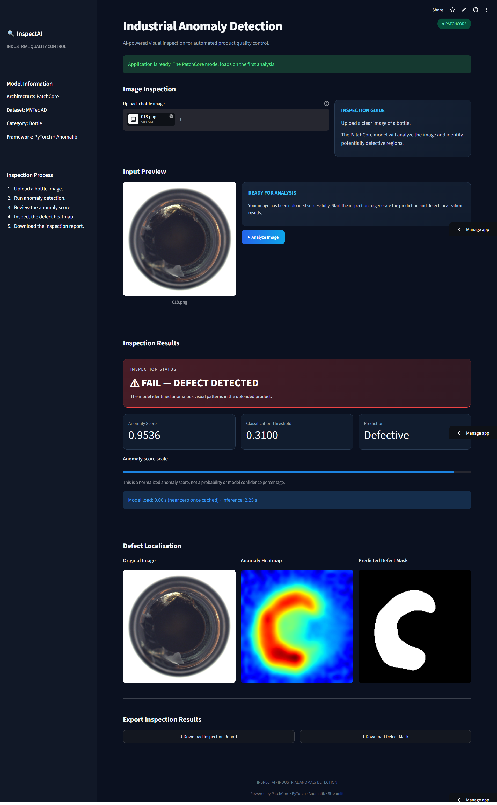
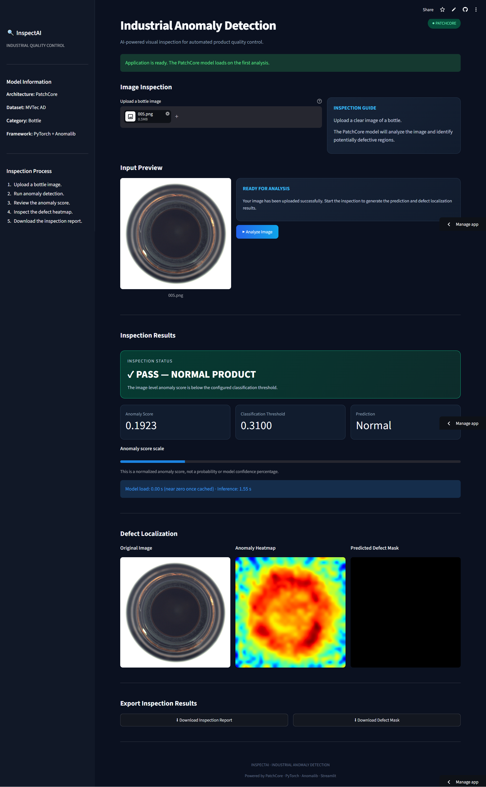

# Industrial Anomaly Detection and Localization using PatchCore

An industrial computer vision project that detects defective bottle images and localizes anomalous regions using **PatchCore**, **PyTorch**, **Anomalib**, and **Streamlit**.

The application allows users to upload bottle images and receive an anomaly prediction, anomaly score, heatmap, and predicted defect mask.

## Project Overview

In industrial manufacturing, identifying defective products is important for maintaining product quality. Manual inspection can be time-consuming and inconsistent.

This project explores an automated visual inspection approach using PatchCore, a deep learning-based anomaly detection method.

The model learns visual patterns from normal bottle images and identifies deviations from those patterns during inference.

**Main capabilities:**
- Image-level anomaly detection (Normal or Defective).
- Anomaly score calculation.
- Pixel-level anomaly localization.
- Anomaly heatmap visualization.
- Predicted defect mask generation.
- Interactive Streamlit application.
- Model checkpoint hosted on Hugging Face.

## Demo

**Application:** https://industrial-anomaly-localization-eszc9foacithund2waymhr.streamlit.app/

**Model:** [PatchCore Bottle Model on Hugging Face](https://huggingface.co/PranavD1712/industrial-anomaly-patchcore-bottle)

**Source Code:** [GitHub Repository](https://github.com/PranavD1712/industrial-anomaly-localization)

## Screenshots

### Dashboard

<p align="center">
  
</p>

### Defective Bottle Prediction

The model flags the bottle as defective (anomaly score 0.9536, threshold 0.31) and localizes the damaged region in the heatmap and predicted mask.

<p align="center">
  
</p>

### Normal Bottle Prediction

The bottle passes inspection (anomaly score 0.1923, below the 0.31 threshold), and the predicted defect mask is empty.

<p align="center">
  
</p>

## Technologies Used

| Technology | Purpose |
|---|---|
| Python | Main programming language |
| PyTorch | Deep learning framework |
| Anomalib | Anomaly detection framework |
| PatchCore | Anomaly detection and localization |
| Wide ResNet-50-2 | Pretrained feature extractor |
| OpenCV | Image processing |
| NumPy | Numerical operations |
| Matplotlib | Anomaly visualization |
| Streamlit | Interactive web application |
| Hugging Face Hub | Model checkpoint hosting |
| Docker | Containerization |

## Dataset

This project uses the **MVTec Anomaly Detection (MVTec AD)** dataset, specifically the `bottle` category.

The dataset contains normal and defective bottle images, along with ground-truth masks for defective samples.

### Dataset Distribution

| Dataset Split | Category | Images |
|---|---|---:|
| Training | Good | 209 |
| Testing | Good | 20 |
| Testing | Broken Large | 20 |
| Testing | Broken Small | 22 |
| Testing | Contamination | 21 |
| **Total Testing Images** | | **83** |

Ground-truth pixel masks are available for the defective test categories.

Dataset source: [MVTec Anomaly Detection Dataset](https://www.mvtec.com/company/research/datasets/mvtec-ad)

Note: The dataset is not included in this GitHub repository. Download it separately and place the bottle category inside the `data/` directory.

## Methodology

### 1. Dataset Preparation

The bottle category is organized into training, testing, and ground-truth mask directories.

The model uses normal training images to establish the visual characteristics of defect-free bottles.

### 2. Feature Extraction

PatchCore uses a pretrained Wide ResNet-50-2 backbone to extract visual features from input images.

These features represent local image patterns and help identify unusual regions.

### 3. Anomaly Detection

PatchCore compares extracted test-image features against a memory bank of normal training features.

Features that differ significantly from the learned normal patterns contribute to higher anomaly scores.

### 4. Anomaly Localization

The model generates an anomaly map that highlights regions with unusual visual patterns.

The predicted mask identifies regions classified as anomalous.

### 5. Classification

The image-level anomaly score is compared with the configured classification threshold.

The threshold used in the application is:

`0.31`

Images are classified as:
- Normal
- Defective

## Model Evaluation

The model was evaluated on 83 test images from the MVTec AD bottle category.

### Image-Level Metrics

| Metric | Result |
|---|---:|
| Image AUROC | 1.0000 |
| Precision | 1.0000 |
| Recall | 0.9841 |
| F1-Score | 0.9920 |

### Pixel-Level Metrics

| Metric | Result |
|---|---:|
| Pixel AUROC | 0.9856 |
| Precision | 0.6521 |
| Recall | 0.8200 |
| F1-Score | 0.7265 |

### Evaluation Notes

Image-level metrics measure how well the model distinguishes normal and defective images.

Pixel-level metrics evaluate how accurately anomalous regions are localized.

These results are from a relatively small test set. The classification threshold was examined using the evaluation data, so the reported results should be considered exploratory rather than an independent benchmark. Further evaluation on a separate, untouched dataset is needed to establish generalization performance.

## Streamlit Application

The project includes an interactive Streamlit dashboard.

Users can upload a bottle image and inspect the model's prediction.

### Application Features

- Upload PNG, JPG, and JPEG images.
- Detect normal and defective bottle images.
- Display anomaly scores and classification thresholds.
- Generate anomaly heatmaps.
- Display predicted defect masks.
- Download prediction reports in JSON format.
- Download predicted masks.
- Display inference time.

The model is loaded on demand when the user requests an image analysis. Streamlit resource caching avoids repeatedly initializing the model during normal application reruns.

## Model Hosting

The trained PatchCore checkpoint is hosted separately on Hugging Face.

Repository:

[PranavD1712/industrial-anomaly-patchcore-bottle](https://huggingface.co/PranavD1712/industrial-anomaly-patchcore-bottle)

The application downloads the checkpoint using `hf_hub_download()`.

```python
from huggingface_hub import hf_hub_download

checkpoint_path = hf_hub_download(
    repo_id="PranavD1712/industrial-anomaly-patchcore-bottle",
    filename="patchcore_bottle.ckpt"
)
```

The downloaded checkpoint is cached locally by the Hugging Face Hub library.

## Installation and Local Setup

### 1. Clone the repository

```bash
git clone https://github.com/PranavD1712/industrial-anomaly-localization.git
```

### 2. Navigate to the project directory

```bash
cd industrial-anomaly-localization
```

### 3. Create a virtual environment

```bash
python -m venv .venv
```

Activate it on Windows:

```powershell
.venv\Scripts\Activate.ps1
```

### 4. Install dependencies

```bash
pip install -r requirements.txt
```

### 5. Run the application

```bash
python -m streamlit run app.py
```

Open the local URL displayed in your terminal, usually:

`http://localhost:8501`

The application downloads the model checkpoint from Hugging Face when the first prediction is requested.

## Project Structure

```text
industrial-anomaly-localization/
│
├── app.py
├── requirements.txt
├── README.md
├── Dockerfile
├── .dockerignore
├── .gitignore
│
├── src/
│   ├── __init__.py
│   ├── train.py
│   ├── predict.py
│   ├── predictor.py
│   ├── evaluate.py
│   ├── threshold_analysis.py
│   ├── inspect_dataset.py
│   └── preprocessing_demo.py
│
├── configs/
├── models/
├── reports/
├── tests/
└── assets/
```

The trained checkpoint and dataset are hosted or stored separately rather than committed to GitHub.

## Performance

The application was tested locally on a CPU-only environment.

Observed measurements during local testing:

| Operation | Observed Time |
|---|---:|
| Initial PatchCore initialization | Approximately 97.21 seconds |
| First image inference | Approximately 9.40 seconds |
| Subsequent image inference | Approximately 2.20 seconds |
| Initial dashboard script execution after lazy loading | Approximately 1.16 seconds |

These are individual local observations, not guaranteed performance benchmarks. Actual performance depends on hardware, application environment, and image characteristics.

## Limitations

- The project currently focuses on the bottle category of MVTec AD.
- Evaluation uses a relatively small test set.
- CPU inference can be slower than GPU inference.
- The selected classification threshold requires validation on independent data.
- Performance on other product categories has not been established.

## Future Improvements

- Extend anomaly detection to additional MVTec AD categories.
- Evaluate performance on independent industrial datasets.
- Improve pixel-level localization.
- Optimize CPU inference performance.
- Add more comprehensive automated tests.
- Improve deployment monitoring and error handling.

## 👨‍💻 Author

**Pranav Deshmukh**
*Computer Vision · Machine Learning*

[](https://www.linkedin.com/in/pranav-deshmukh2004)

---

*This project was developed as a hands-on exploration of industrial visual inspection using deep learning and anomaly detection.*