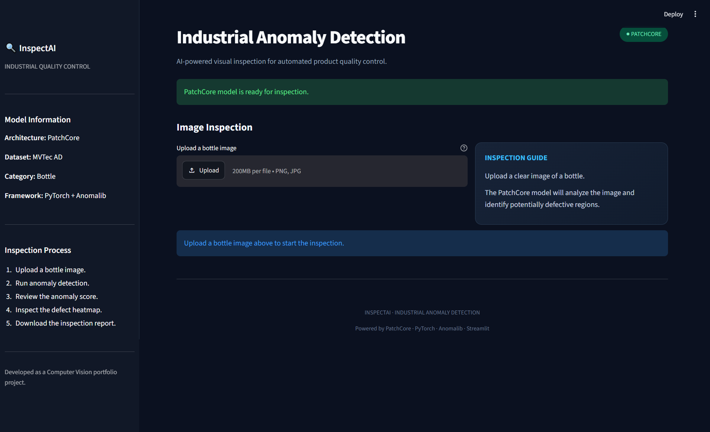

# Industrial Anomaly Detection and Localization using PatchCore

An industrial computer vision project that detects defective products and localizes anomalous regions in bottle images using **PatchCore**, **PyTorch**, and **Anomalib**. The project includes a Streamlit web application for interactive image inspection, anomaly visualization, and defect localization.

## Project Overview

In manufacturing industries, identifying defective products is an important part of quality control. Traditional manual inspection can be time-consuming and may not consistently identify small visual defects.

This project explores an automated visual inspection approach using deep learning-based anomaly detection.

The system learns the visual characteristics of normal bottle images and identifies deviations from those patterns during inference. It produces an image-level anomaly score and a pixel-level anomaly map to help identify potentially defective regions.

## Key Features

- Industrial anomaly detection using PatchCore.
- Training using normal product images.
- Image-level anomaly classification.
- Pixel-level anomaly localization.
- Anomaly heatmap generation.
- Binary defect mask generation.
- Configurable classification threshold.
- Interactive Streamlit application.
- JSON-based inspection report export.
- Defect mask download.

## Technology Stack

| Category | Technologies |
|---|---|
| Programming Language | Python |
| Deep Learning | PyTorch |
| Anomaly Detection | Anomalib, PatchCore |
| Image Processing | OpenCV, Pillow |
| Data Visualization | Matplotlib |
| Machine Learning Evaluation | Scikit-learn |
| Web Application | Streamlit |
| Development Environment | PyCharm, Python Virtual Environment |
| Version Control | Git and GitHub |

## Dataset

This project uses the **MVTec Anomaly Detection (MVTec AD)** dataset, specifically the `bottle` category.

The dataset contains normal training images, normal and defective test images, and ground-truth segmentation masks for defective samples.

### Dataset Details

| Dataset Split | Category | Number of Images |
|---|---|---:|
| Training | Good | 209 |
| Testing | Good | 20 |
| Testing | Broken Large | 20 |
| Testing | Broken Small | 22 |
| Testing | Contamination | 21 |
| Ground Truth Masks | Broken Large | 20 |
| Ground Truth Masks | Broken Small | 22 |
| Ground Truth Masks | Contamination | 21 |

**Total test images: 83**

The training set contains only normal bottle images. The model learns normal visual patterns and identifies deviations during testing.

Dataset source: [MVTec Anomaly Detection Dataset](https://www.mvtec.com/research-teaching/datasets/mvtec-ad)

**Dataset License:** MVTec AD is provided under its own license for non-commercial research purposes. Refer to the official license before downloading or using the dataset. The dataset is not included in this GitHub repository.

## Model Architecture: PatchCore

PatchCore is an industrial anomaly detection method that uses pretrained CNN features to identify unusual visual patterns.

Unlike conventional supervised image classification, PatchCore does not require labeled defective images for its normal-pattern training process.

### How PatchCore Works

1. **Feature Extraction:** A pretrained Wide ResNet-50-2 extracts visual features from normal training images.
2. **Memory Bank:** Representative feature embeddings from normal images are stored.
3. **Coreset Selection:** A smaller representative subset of features is selected to reduce memory requirements.
4. **Anomaly Detection:** During inference, test image features are compared with the stored normal feature representations.
5. **Anomaly Localization:** Differences between test features and normal feature representations generate an anomaly map.
6. **Classification:** An image-level anomaly score is compared with a classification threshold to determine whether the image is normal or defective.

### Model Configuration

| Parameter | Configuration |
|---|---|
| Model | PatchCore |
| Backbone | Wide ResNet-50-2 |
| Framework | PyTorch |
| Library | Anomalib 2.6.2 |
| Input Image Size | 256 × 256 |
| Device | CPU |
| Dataset Category | Bottle |

## Project Workflow

The project follows this workflow:

1. Dataset inspection and exploration.
2. Image preprocessing and visualization.
3. PatchCore model training.
4. Model checkpoint saving.
5. Image-level and pixel-level evaluation.
6. Classification threshold analysis.
7. Single-image inference.
8. Anomaly heatmap and defect mask generation.
9. Streamlit application development.

## Model Evaluation

The trained PatchCore model was evaluated on the 83 test images.

### Image-Level Evaluation

The following results were obtained using the default image-level classification threshold of 0.5:

| Metric | Result |
|---|---:|
| AUROC | 1.0000 |
| Precision | 1.0000 |
| Recall | 0.9841 |
| F1-Score | 0.9920 |
| Accuracy | 98.80% |

Confusion Matrix:

| | Predicted Normal | Predicted Defective |
|---|---:|---:|
| Actual Normal | 20 | 0 |
| Actual Defective | 1 | 62 |

### Pixel-Level Evaluation

Pixel-level metrics evaluate how accurately the model identifies defective regions.

| Metric | Result |
|---|---:|
| AUROC | 0.9856 |
| Precision | 0.6521 |
| Recall | 0.8200 |
| F1-Score | 0.7265 |

The pixel-level results indicate that localization is more challenging than image-level classification, particularly because some normal pixels are incorrectly marked as anomalous.

### Threshold Analysis

An additional threshold analysis was performed to investigate how changing the image-level classification threshold affects precision, recall, and F1-score.

The exploratory analysis identified:

- Selected threshold: `0.31`
- Validation F1-score: `1.0000`
- Holdout F1-score: `1.0000`

**Evaluation limitation:** The threshold analysis used a split of the existing 83 test images. These images had already been examined during model evaluation and threshold experimentation. Therefore, the holdout results are exploratory and should not be considered an independent benchmark. A separate untouched test dataset is needed for a more reliable final performance estimate.

The threshold configuration is stored in:

`reports/threshold_analysis.json`

The threshold analysis graph is stored in:

`reports/threshold_analysis.png`

## Streamlit Application

An interactive Streamlit application was developed to demonstrate the trained anomaly detection model.


## Application Screenshots

### Streamlit Dashboard


### Defective Bottle Prediction


### Normal Bottle Prediction


### Application Features

- Upload bottle images.
- Perform automated anomaly detection.
- Display image-level anomaly scores.
- Classify products as Normal or Defective.
- Visualize anomaly heatmaps.
- Display predicted binary defect masks.
- Download inspection reports in JSON format.
- Download predicted defect masks as PNG images.

### Prediction Output

The application generates three visual outputs:

1. Original input image.
2. Anomaly heatmap.
3. Predicted defect segmentation mask.

The application uses the trained PatchCore checkpoint and the configured image-level classification threshold.

## Project Structure

```text
industrial-anomaly-localization/
│
├── app.py
│
├── configs/
│
├── src/
│   ├── __init__.py
│   ├── train.py
│   ├── inspect_dataset.py
│   ├── preprocessing_demo.py
│   ├── predict.py
│   ├── predictor.py
│   ├── evaluate.py
│   └── threshold_analysis.py
│
├── data/
│   └── bottle/
│       ├── train/
│       ├── test/
│       └── ground_truth/
│
├── reports/
│   ├── threshold_analysis.json
│   ├── threshold_analysis.png
│   ├── single_image_prediction.png
│   └── prediction_result.png
│
├── results/
│   └── PatchCore/
│
├── tests/
│
├── requirements.txt
├── .gitignore
└── README.md
```

Note: The dataset and trained checkpoint directories are kept locally and excluded from GitHub.

## Installation and Setup

### 1. Clone the Repository

```bash
git clone https://github.com/YOUR_USERNAME/industrial-anomaly-localization.git

cd industrial-anomaly-localization
```

### 2. Create a Virtual Environment

```bash
python -m venv .venv
```

Activate it on Windows:

```powershell
.venv\Scripts\activate
```

### 3. Install Dependencies

```bash
pip install -r requirements.txt
```

### 4. Download the Dataset

Download MVTec AD from the official website:

https://www.mvtec.com/research-teaching/datasets/mvtec-ad

Extract the bottle category into:

```text
data/bottle/
```

Ensure the dataset has the expected `train`, `test`, and `ground_truth` directories.

### 5. Train the Model

```bash
python src/train.py
```

The training process generates the PatchCore checkpoint in the Anomalib results directory.

### 6. Run the Streamlit Application

After training and confirming that the checkpoint and threshold configuration exist, execute:

```bash
streamlit run app.py
```

The application will normally be available at:

```text
http://localhost:8501
```

## Limitations

- The current implementation focuses only on the bottle category.
- The model uses CPU inference, which may be slower than GPU inference.
- Evaluation is based on a relatively small test set of 83 images.
- Threshold analysis has not yet been validated on an independent dataset.
- Pixel-level localization still produces false-positive regions.
- The current application is a local prototype and has not yet been deployed for production use.

## Future Improvements

- Extend anomaly detection to additional MVTec AD categories.
- Improve pixel-level localization and reduce false positives.
- Perform independent threshold calibration and evaluation.
- Add batch image inspection.
- Develop a REST API using FastAPI.
- Containerize the application using Docker.
- Deploy the application to a cloud platform.
- Add automated testing and continuous integration.

## 👨‍💻 Author

**Pranav Deshmukh**
*Computer Vision · Machine Learning*

[](https://www.linkedin.com/in/pranav-deshmukh2004)
